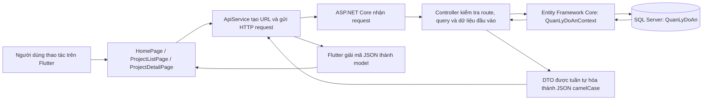

# Luồng hoạt động của API Week10

Tài liệu này mô tả cách ứng dụng Flutter Week10 gửi request đến ASP.NET Core Web API, cách API truy vấn SQL Server và trả dữ liệu về Flutter. API hiện dùng Entity Framework Core với cơ sở dữ liệu `QuanLyDoAn`.

## 1. Sơ đồ tổng quan



Một request đọc dữ liệu đi qua các bước sau:

1. Người dùng mở màn hình hoặc chọn bộ lọc trong ứng dụng Flutter.
2. Widget gọi một hàm trong `ApiService`, ví dụ `getLoaiDeTai()` hoặc `getDeTai(maLoai: ..., maCN: ...)`.
3. `ApiService` ghép địa chỉ máy chủ với đường dẫn API, gửi HTTP GET và chờ tối đa 15 giây.
4. ASP.NET Core định tuyến request đến Controller tương ứng.
5. Controller dùng `QuanLyDoAnContext` để truy vấn SQL Server qua Entity Framework Core.
6. Controller chiếu kết quả thành DTO rồi trả mã HTTP và nội dung JSON.
7. `ApiService` giải mã JSON thành các model Dart; Widget cập nhật giao diện hoặc hiển thị trạng thái lỗi.

## 2. API được khởi tạo như thế nào?

Các bước cấu hình máy chủ nằm trong [`QuanLyDoAnApi/Program.cs`](QuanLyDoAnApi/Program.cs):

- Đọc chuỗi kết nối `ConnectionStrings:QuanLyDoAn`. Nếu giá trị rỗng, ứng dụng dừng với lỗi cấu hình.
- Đăng ký `QuanLyDoAnContext` và SQL Server vào dependency injection. ASP.NET Core tạo context và truyền vào Controller qua constructor.
- Đăng ký Controller, Swagger và `ProblemDetails`.
- Dùng camelCase khi chuyển tên thuộc tính C# thành tên trường JSON để khớp với model Dart.
- Chỉ trong môi trường Development, bật CORS và Swagger UI.
- Ánh xạ các Controller bằng `app.MapControllers()`.

[`QuanLyDoAnApi/Data/QuanLyDoAnContext.cs`](QuanLyDoAnApi/Data/QuanLyDoAnContext.cs) ánh xạ các bảng `LoaiDeTai`, `ChuyenNganh`, `DeTai` và `NganhHoc`. Ứng dụng không tự tạo database hoặc chạy migration; SQL Server và database `QuanLyDoAn` cần được chuẩn bị trước theo [`QuanLyDoAn.sql`](QuanLyDoAn.sql).

## 3. Các API hiện có

| Phương thức | Đường dẫn | Mục đích | Nơi xử lý |
|---|---|---|---|
| GET | `/api/loai-de-tai` | Lấy danh sách loại đề tài | `LoaiDeTaiController.GetAll` |
| GET | `/api/loai-de-tai/{maLoai}` | Lấy một loại đề tài theo mã | `LoaiDeTaiController.GetById` |
| POST | `/api/loai-de-tai` | Tạo loại đề tài | `LoaiDeTaiController.Create` |
| PUT | `/api/loai-de-tai/{maLoai}` | Đổi tên loại đề tài | `LoaiDeTaiController.Update` |
| DELETE | `/api/loai-de-tai/{maLoai}` | Xóa loại đề tài nếu chưa được sử dụng | `LoaiDeTaiController.Delete` |
| GET | `/api/chuyen-nganh` | Lấy danh sách chuyên ngành | `ChuyenNganhController.GetAll` |
| GET | `/api/de-tai` | Lấy danh sách đề tài; có thể lọc theo loại và chuyên ngành | `DeTaiController.GetAll` |
| GET | `/api/de-tai/{maDeTai}` | Lấy thông tin chi tiết đề tài | `DeTaiController.GetById` |
| GET | `/api/nganh-hoc` | Lấy danh sách ngành học | `NganhHocController.GetAll` |
| GET | `/api/nganh-hoc/{maNganh}` | Lấy một ngành học theo mã | `NganhHocController.GetById` |

Các thao tác ghi hiện chỉ áp dụng cho `LoaiDeTai`. API chưa có POST/PUT/DELETE cho đề tài, chuyên ngành hoặc ngành học.

### Lọc danh sách đề tài

Hai tham số query là tùy chọn:

```text
GET /api/de-tai?maLoai=KLKS&maCN=HTTT
```

- Chỉ `maLoai`: lọc theo loại đề tài.
- Chỉ `maCN`: lọc theo chuyên ngành.
- Không truyền tham số: trả về tất cả đề tài.

Truy vấn danh sách kết hợp đề tài với chuyên ngành và loại đề tài để trả tên hiển thị cùng mã. Bảng loại đề tài được nối kiểu LEFT JOIN, vì vậy đề tài có `MaLoai = NULL` vẫn xuất hiện khi không lọc theo `maLoai`.

## 4. Luồng Flutter đang sử dụng

### Màn hình chính

Khi `HomePage` được mở, `_loadHomeData()` gọi đồng thời:

- `GET /api/loai-de-tai` để tải các loại đề tài.
- `GET /api/chuyen-nganh` để tải các chuyên ngành.

Ứng dụng chuyển JSON thành `LoaiDeTai` và `ChuyenNganh`, sắp xếp theo thứ tự mã đang khai báo trong giao diện rồi hiển thị. Nếu request lỗi, màn hình hiển thị thông báo và cho phép tải lại.

### Danh sách đề tài

Khi người dùng chọn loại hoặc chuyên ngành, `ProjectListPage` gọi `getDeTai()` với bộ lọc hiện tại. `ApiService` thêm các giá trị này vào query string; ví dụ:

```text
GET /api/de-tai?maLoai=KLKS
```

Khi bỏ bộ lọc, Flutter gọi `/api/de-tai` không kèm query. Khi cần hiển thị các nút lọc theo loại, màn hình cũng gọi `GET /api/loai-de-tai`.

### Chi tiết đề tài

Khi người dùng chọn một đề tài, ứng dụng mở `ProjectDetailPage` và gọi:

```text
GET /api/de-tai/{maDeTai}
```

API trả thông tin chi tiết, gồm mã/tên đề tài, số lượng sinh viên tối đa, chuyên ngành, giảng viên hướng dẫn và yêu cầu đề tài. Nếu mã không tồn tại, API trả 404 và Flutter hiển thị trạng thái lỗi.

### Chuyển JSON thành model

`ApiService` giải mã JSON UTF-8. Danh sách được chuyển qua các hàm `fromJson` trong `lib/models/`; ví dụ `soLuongSinhVienToiDa` được chuyển thành số nguyên và các trường loại đề tài có thể `null` được đọc dưới dạng nullable.

## 5. Ví dụ CRUD loại đề tài

Các thao tác này có thể được gọi qua Swagger hoặc HTTP client. Flutter hiện chỉ có các hàm GET; giao diện Flutter chưa gọi POST, PUT hoặc DELETE.

### Tạo loại đề tài

Request:

```http
POST /api/loai-de-tai
Content-Type: application/json
```

```json
{
  "maLoai": "NCKH",
  "tenLoai": "Nghiên cứu khoa học"
}
```

Thành công trả `201 Created` cùng bản ghi vừa tạo và đường dẫn đến endpoint chi tiết. Mã loại dài tối đa 10 ký tự; tên loại dài tối đa 100 ký tự. Hai giá trị phải khác rỗng, mã và tên không được trùng dữ liệu hiện có.

### Cập nhật tên

```http
PUT /api/loai-de-tai/NCKH
Content-Type: application/json
```

```json
{
  "tenLoai": "Nghiên cứu ứng dụng"
}
```

Mã loại được lấy từ URL và không thay đổi. Thành công trả `200 OK` cùng dữ liệu sau cập nhật.

### Xóa loại đề tài

```http
DELETE /api/loai-de-tai/NCKH
```

Thành công trả `204 No Content`. Nếu mã không tồn tại, trả `404 Not Found`. Nếu loại đang được một đề tài sử dụng, API trả `409 Conflict` để giữ nguyên liên kết dữ liệu.

## 6. Mã HTTP và xử lý lỗi

| Mã | Ý nghĩa trong API này |
|---|---|
| 200 | Request đọc hoặc cập nhật thành công |
| 201 | Tạo loại đề tài thành công |
| 204 | Xóa loại đề tài thành công, không có response body |
| 400 | Body đầu vào sai hoặc không đạt kiểm tra bắt buộc/độ dài |
| 404 | Không tìm thấy bản ghi theo mã |
| 409 | Mã/tên bị trùng hoặc loại đề tài đang được sử dụng |
| 500 | Lỗi máy chủ chưa được xử lý cụ thể; máy chủ trả ProblemDetails |

Trong Flutter, `_getJson()` phát sinh `ApiException` khi HTTP trả mã ngoài khoảng 2xx, request quá 15 giây, JSON lỗi hoặc không kết nối được. Các trang bắt lỗi này để hiển thị thông báo và nút thử lại. Với response không thành công, Flutter hiện hiển thị mã HTTP; nó chưa đọc chi tiết `ProblemDetails` từ body.

## 7. Chạy và cấu hình địa chỉ

Từ thư mục `code/Week10`, chạy API bằng profile HTTP:

```powershell
dotnet run --project .\QuanLyDoAnApi\QuanLyDoAnApi.csproj --launch-profile http
```

Theo [`launchSettings.json`](QuanLyDoAnApi/Properties/launchSettings.json), địa chỉ máy phát triển là `http://localhost:5130` và Swagger UI là `http://localhost:5130/swagger`.

Flutter đặt base URL trong [`api_service.dart`](FlutterBaiTap02/lib/services/api_service.dart). Giá trị mặc định là `http://10.0.2.2:5130`, địa chỉ dùng để Android Emulator truy cập máy chủ đang chạy trên máy tính. Có thể ghi đè bằng `--dart-define`:

```powershell
flutter run --dart-define=API_BASE_URL=http://10.0.2.2:5130
```

Nếu chạy trên điện thoại thật, thay `10.0.2.2` bằng IP LAN của máy tính. Máy tính và điện thoại cần cùng mạng, API phải lắng nghe trên địa chỉ có thể truy cập từ thiết bị và firewall phải cho phép cổng API.

## 8. Cấu trúc các file liên quan

| File/thư mục | Trách nhiệm |
|---|---|
| `QuanLyDoAnApi/Program.cs` | Cấu hình dịch vụ, JSON, CORS, Swagger, lỗi và route Controller |
| `QuanLyDoAnApi/Controllers/` | Nhận request, chạy truy vấn hoặc thay đổi dữ liệu, trả HTTP response |
| `QuanLyDoAnApi/Data/QuanLyDoAnContext.cs` | Khai báo DbSet và ánh xạ entity với SQL Server |
| `QuanLyDoAnApi/Entities/` | Mô tả cấu trúc bảng dữ liệu |
| `QuanLyDoAnApi/DTOs/` | Định dạng dữ liệu gửi vào/trả ra API |
| `FlutterBaiTap02/lib/services/api_service.dart` | Tạo URL, gửi request và xử lý JSON/HTTP |
| `FlutterBaiTap02/lib/models/` | Chuyển JSON response thành đối tượng Dart |
| `FlutterBaiTap02/lib/pages/` | Tải dữ liệu, cập nhật trạng thái và hiển thị giao diện |

## 9. Giới hạn hiện tại

- API hiện chưa cấu hình đăng nhập, JWT hoặc `[Authorize]`; các endpoint không yêu cầu token.
- CORS chỉ được cấu hình trong Development. CORS là chính sách của trình duyệt; nó không thay thế xác thực API.
- Flutter đang đọc dữ liệu qua GET. CRUD loại đề tài mới được cung cấp ở phía API và chưa có form quản lý tương ứng trong ứng dụng Flutter.
- API cần kết nối đến SQL Server đã có database và schema đúng; `QuanLyDoAnContext` không tự tạo database.
